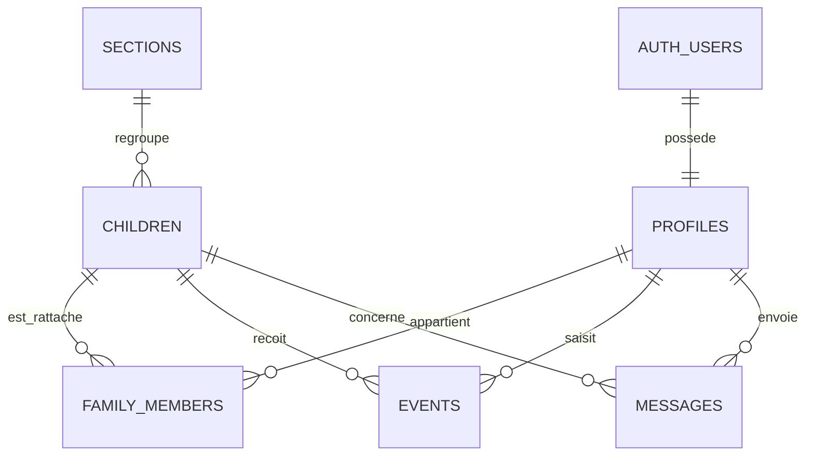

# Modèle de données

## Choix de modélisation
- `profiles` étend `auth.users` et contient le rôle contrôlé par l'application.
- `family_members` modélise la relation plusieurs-à-plusieurs : un enfant peut avoir deux parents et un parent plusieurs enfants.
- `events` conserve l'auteur staff afin de l'afficher dans la timeline.
- Les types d'événement et statuts utilisent des enums Postgres.
- `medication_authorized` est vérifié par l'interface, l'action serveur et un trigger SQL.

## Sécurité
Toutes les tables publiques activent RLS. Le staff accède à tous les enfants. Un parent accède seulement aux lignes reliées à son `auth.uid()` dans `family_members`. Aucun rôle ne repose sur `user_metadata`; le trigger utilise `raw_app_meta_data`.
